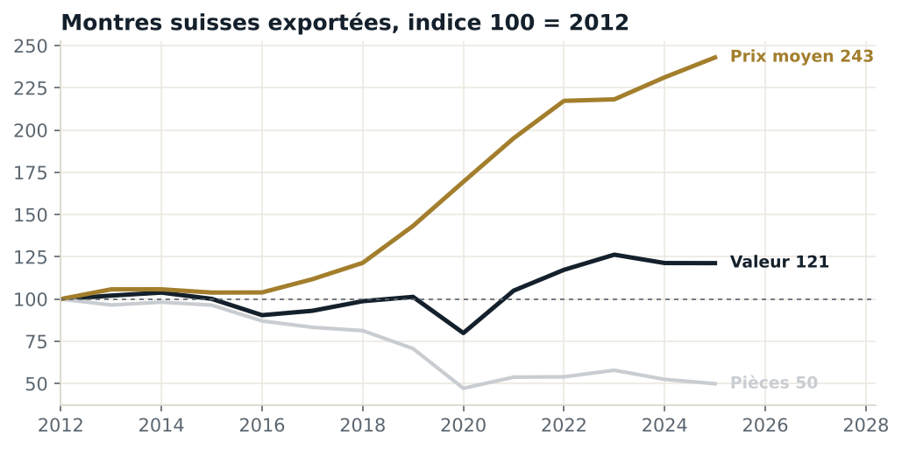
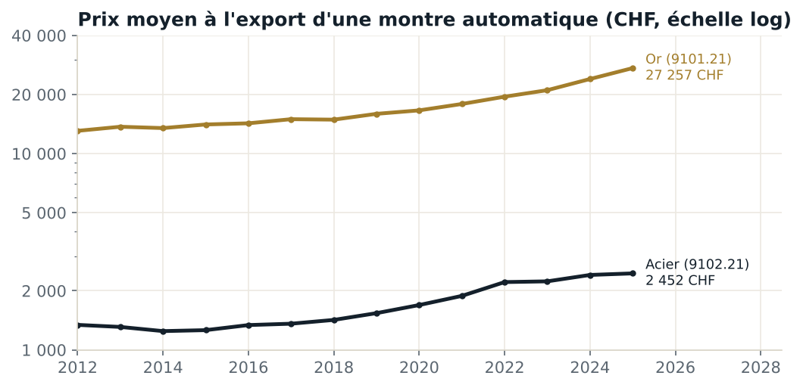
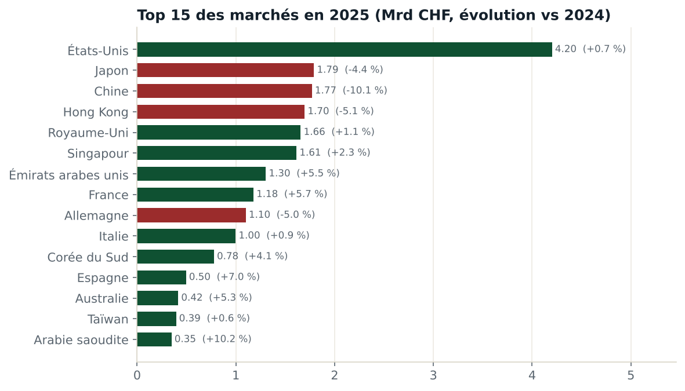

# Note de synthèse : où se crée la valeur de l'horlogerie suisse

**À** : direction commerciale d'une maison horlogère (cas d'étude)
**Données** : exportations suisses de montres-bracelets et de poche (codes SH 9101 et 9102), 2012 à 2025, en CHF
**Tableaux de bord associés** : classeur Tableau, 3 tableaux de bord

---

## En bref

L'horlogerie suisse exporte **deux fois moins de montres qu'en 2012, pour 21 % de valeur en plus**. Le prix moyen à l'export a été multiplié par 2,4 et atteint **1 679 CHF** en 2025. Cette montée en gamme repose sur la **montre mécanique automatique**, le segment de Rolex : elle pèse **75 % de la valeur** exportée. Après un record en 2023, la valeur recule en 2024 (−3,9 %) puis se stabilise en 2025 (−0,05 %), alors que le nombre de pièces continue de baisser. La géographie bascule : les **États-Unis** sont devenus de loin le premier marché, tandis que **Hong Kong et la Chine reculent**.

## 1. Moins de montres, plus de valeur

| Indicateur | 2012 | 2025 | Évolution |
|---|---|---|---|
| Valeur exportée | 20,2 Mrd CHF | 24,5 Mrd CHF | +21 % |
| Montres exportées | 29,3 millions | 14,6 millions | −50 % |
| Prix moyen à l'export | 691 CHF | 1 679 CHF | +143 % |

Le quartz d'entrée de gamme a cédé la place aux montres connectées. La Suisse s'est recentrée sur ce qu'elle seule sait vendre cher : la mécanique.

## 2. Le cœur du luxe : la montre mécanique automatique

| Segment 2025 | Valeur | Pièces | Prix moyen à l'export |
|---|---|---|---|
| Automatiques, toutes matières | 18,5 Mrd CHF (75 % de la valeur) | 5,0 millions | 3 707 CHF |
| dont boîte en acier (9102.21) | 11,6 Mrd CHF | 4,7 millions | 2 452 CHF |
| dont boîte en or (9101.21) | 6,9 Mrd CHF | 0,25 million | 27 257 CHF |

Depuis 2012, le prix moyen à l'export d'une automatique en acier a progressé de **83 %**, celui d'une automatique en or de **109 %**. La valeur des automatiques a augmenté de 23 % par rapport à 2019 alors que leur volume a baissé de 29 % : la croissance vient entièrement du prix et du mix.

## 3. Les marchés : les États-Unis en tête, l'Asie traditionnelle recule

| Marché | Valeur 2025 | Part | Évolution vs 2024 | Évolution vs 2019 |
|---|---|---|---|---|
| États-Unis | 4,20 Mrd CHF | 17,1 % | +0,7 % | **+83 %** |
| Japon | 1,79 Mrd CHF | 7,3 % | −4,4 % | +17 % |
| Chine | 1,77 Mrd CHF | 7,2 % | −10,1 % | −6 % |
| Hong Kong | 1,70 Mrd CHF | 6,9 % | −5,1 % | **−32 %** |
| Royaume-Uni | 1,66 Mrd CHF | 6,8 % | +1,1 % | +27 % |
| Singapour | 1,61 Mrd CHF | 6,6 % | +2,3 % | +30 % |
| Émirats arabes unis | 1,30 Mrd CHF | 5,3 % | +5,5 % | +42 % |

Les 5 premiers marchés concentrent **45 %** de la valeur. Singapour se distingue par un prix moyen très élevé (7 040 CHF par montre), signe d'une clientèle concentrée sur le très haut de gamme.

## Recommandations

1. **Réduire la dépendance à la Chine et à Hong Kong** : réallouer l'effort commercial vers les marchés en croissance et à forte valeur (Émirats, Singapour, Japon, Royaume-Uni).
2. **Sécuriser le marché américain** : premier marché et principal moteur de croissance depuis 2019, mais exposé aux décisions tarifaires des États-Unis. Suivre ce marché chaque mois et préparer des scénarios de prix.
3. **Piloter la valeur, pas le volume** : le bon indicateur est le prix moyen par montre et le mix acier/or, pas le nombre de pièces, qui baisse structurellement.
4. **Surveiller le plateau** : après le record de 2023, deux années sans croissance en valeur. Une alerte quand l'évolution sur un an devient négative sur un marché clé permettrait de réagir plus tôt.

## Limites

- **Exportations, pas ventes** : les douanes mesurent ce qui quitte la Suisse, pas les ventes au client final. Hong Kong, Singapour et Dubaï sont aussi des plaques tournantes qui réexportent.
- **Prix à l'export, pas prix public** : le prix de vente en boutique est plus élevé (marges de distribution, taxes).
- **Pas de détail par marque** : les douanes ne publient pas les chiffres par maison. Selon l'estimation du rapport Morgan Stanley et LuxeConsult, Rolex représente à elle seule environ un tiers de la valeur du marché horloger suisse.
- **Conversion** : les données internationales sont publiées en USD ; elles sont reconverties en CHF au cours moyen annuel de la BNS, ce qui retrouve les ordres de grandeur publiés par la Fédération de l'industrie horlogère suisse.
